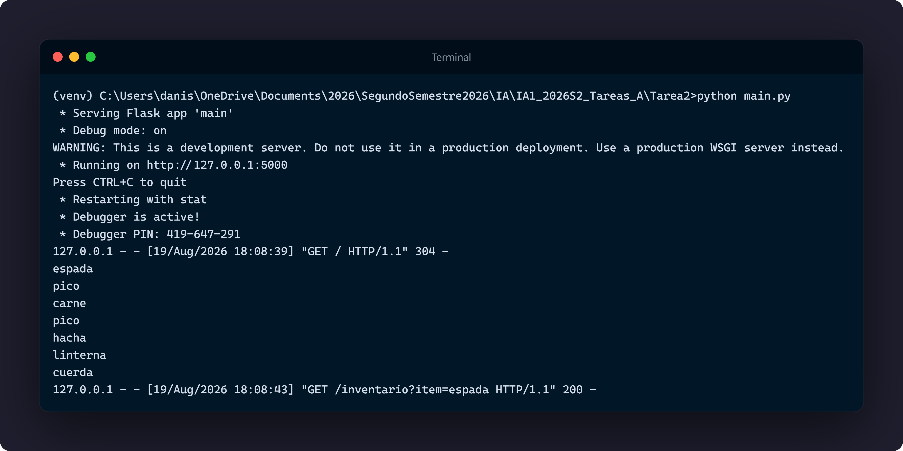

# Manual Técnico - Tarea 2  

**Curso:** Inteligencia Artificial 1 - Sección A  
**Laboratorio Segundo Semestre 2026**   
**Nombre:** Daniel Estuardo Salvatierra Macajola  
**Carné:** 202202768   

---
## 1. Descripción General
El sistema implementa un motor de inferencia en Prolog para la gestión y procesamiento de inventarios de un videojuego. Este motor se comunica con un backend en Python con Flask usando PySwip, exponiendo un servicio de API REST que es consumido dinámicamente por un frontend web con HTML y JavaScript.

---

## 2. Arquitectura y Flujo de Comunicación

```
1. Frontend: Realiza petición GET (/inventario?item=espada) mediante fetch().
2. Backend con Flask: Recibe el parámetro y arma la consulta para PySwip.
3. Prolog: Ejecuta la inferencia lógica, unifica variables (Total, Listas procesadas) e imprime en consola mediante recursión [H|T].
4. Backend con Flask: Recibe las variables de Prolog, las transforma a tipos nativos y serializa a JSON.
5. Frontend: Procesa el JSON y realiza el renderizado dinámico en el DOM.
```

---

## 3. Documentacion Tecnica del Codigo

### 3.1. Motor Lógico

1. **Hechos:**
   * `items_principales`: Almacena una lista de 4 ítems con un elemento duplicado `pico`.
   * `items_secundarios`: Almacena una lista de 3 ítems distintos.

2. **Recorrido Recursivo (`mostrar_inventario`):**
   * Caso Base `mostrar_inventario([]).`: Se activa cuando la lista queda vacía, finalizando la recursión con éxito.
   * Caso Recursivo `mostrar_inventario([H|T])`: Desestructura la lista en Cabeza (`H`) y Cola (`T`). Imprime el ítem actual mediante `write(H), nl` y realiza la llamada recursiva con `T` para ir avanzando de elementos.

3. **Regla Principal (`procesar_inventario`):**
   * `append`: Une las listas `items_principales` y `items_secundarios` en `InventarioTotal`.
   * `length`: Determina la longitud total de la lista InventarioTotal.
   * `member`: Verifica si el `ItemBuscado` existe dentro del inventario.
   * `reverse`: Invierte el orden de los elementos.
   * `sort`: Ordena la lista y elimina duplicados en `InventarioUnico`.
   * `msort`: Ordena la lista conservando duplicados en `InventarioOrdenado`.
   * `mostrar_inventario`: Ejecuta la impresión recursiva en consola.

---

### 3.2. Backend `main.py`

* **Frameworks y Librerías:** `Flask`, `flask_cors` y `PySwip`.
* **CORS:** Middleware activado `CORS(app)` para permitir el acceso cruzado desde navegadores.
* **Integración PySwip:** Carga el archivo mediante `prolog.consult("Tarea2.pl")` y ejecuta consultas con `prolog.query(...)`.
* **Sanitización de Datos:** Se implementa `limpiar_lista()` para convertir instancias de `Atom` de Prolog a strings estándar de Python, para evitar errores de serialización en `jsonify`.
* **Rutas:**
  * `GET /`: Sirve la interfaz web mediante `send_file('index.html')`.
  * `GET /inventario?item=<nombre>`: Ejecuta la inferencia lógica y devuelve un objeto JSON estructurado con códigos HTTP 200, 400, 404 o 500.

---

### 3.3. Frontend (`index.html`)

* **Formulario y Captura:** Input de texto para capturar el término de búsqueda.
* **Consumo Asíncrono:** Utiliza la API `fetch` para comunicarse con el endpoint `/inventario`.
* **Mapeo en el DOM:** Incluye de forma ordenada los resultados devueltos en un contenedor HTML.

---

## 4. Instrucciones de Ejecución

1. **Configurar el entorno virtual e instalar dependencias:**
   ```bash
   python -m venv venv
   # En Windows:
   venv\Scripts\activate
   # En Linux/Mac:
   source venv/bin/activate

   pip install Flask flask-cors pyswip
   ```

2. **Levantar el servidor backend:**
   ```bash
   python main.py
   ```

3. **Acceder a la aplicación:**
   Abre tu navegador e ingresa a:
   ```
   http://127.0.0.1:5000/
   ```

---

## 5. Evidencias de Ejecución

### 5.1. Consulta Exitosa en Frontend


### 5.2. Impresión Recursiva en Consola del Backend



### 5.3. Manejo de Errores item no encontrado


